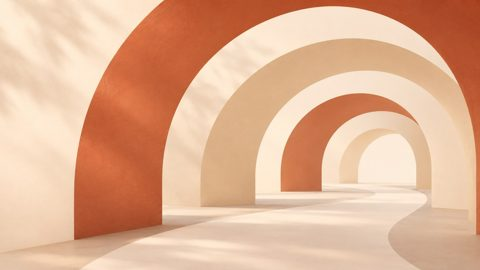
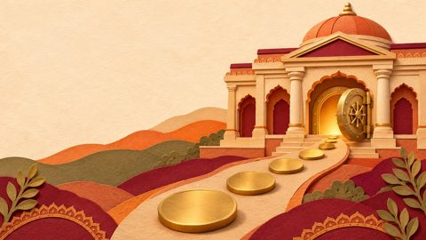
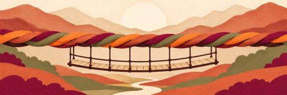
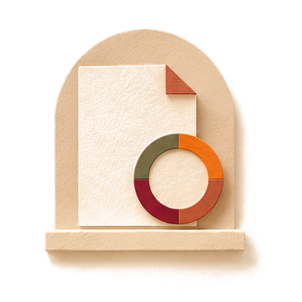
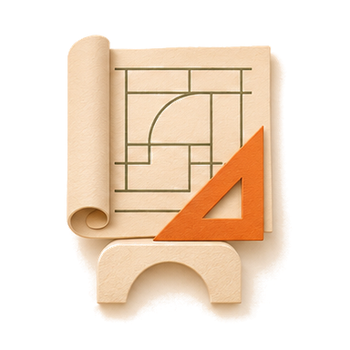

<div align="center">

# Wohlig Visual Library

**399 earthy papercraft images, icons, backgrounds and brand assets for Wohlig presentations, documents and web pages.**

### [Browse the gallery](https://wohlig.github.io/wohlig-visual-library/)

Search, filter by folder, click any image for its path, size and the prompt that made it.

<a href="https://wohlig.github.io/wohlig-visual-library/">  </a>
<br>
<a href="https://wohlig.github.io/wohlig-visual-library/">  </a>
<br>
<a href="https://wohlig.github.io/wohlig-visual-library/">  </a>

</div>

## Quick start

1. **Browse:** open the [gallery](https://wohlig.github.io/wohlig-visual-library/), find an image, copy its path.
2. **Get the files:**
   ```bash
   git clone https://github.com/wohlig/wohlig-visual-library.git
   git -C wohlig-visual-library pull    # later, to pick up new art
   ```
   Or open an image in the gallery and use *Open full size* to download just that one.
3. **Use it:** drop it into your deck, doc or page. For Claude Slides decks, the `wohlig-claude-slides`
   skill (in the [`wohlig-presentations`](https://github.com/wohlig/wohlig-claude-plugins) plugin) reads
   this library for you.

Brand colours: deep maroon `#800D35`, terracotta `#C85F44`, sunset orange `#F7781D`, warm ivory `#FFF7E9`,
earthen beige `#EAD9C2`, muted olive `#76775A`, with brass accents. Almost everything was made with
**Codex** image generation in a tactile papercraft and clay style.

| Folder | Images |
| --- | --- |
| `icons/` (+ `icons/sliced/`) | 109 |
| `illustrations/` | 86 |
| `heroes/` | 63 |
| `photography/` | 39 |
| `backgrounds/` | 37 |
| `objects/` | 16 |
| `client-logos/` | 12 |
| `icon-sets/` | 11 |
| `brand/` | 8 |
| `ui-mockups/` | 7 |
| `motifs/` | 6 |
| `slide-bookends/` | 5 |

## Folders

| Folder | What's in it | Use it for |
| --- | --- | --- |
| `heroes/` | Wide papercraft brand art: arches, sunrises, flowers, shields, workshops | Covers, section dividers, full or half-bleed slides, web banners |
| `illustrations/` | Scenes for concepts, industries and services (`industry-*`, `service-*`) | Concept slides, case studies, industry pages |
| `backgrounds/` | Quiet textures and gradients (`bg-*`, paper, rooms) | Behind text on slides and docs; video-call backgrounds |
| `motifs/` | Line motifs: eight-petal flower, nested arches, dot grid | Corners, watermarks, dividers |
| `photography/` | Warm photographic places and still lifes (`photo-still-*`) | Places, moods and metaphors |
| `objects/` | Single photographic objects on cream | Cards and callouts |
| `icons/` | Transparent PNG papercraft icons: `icon-dept-*` (14 departments), `icon-*` concepts | Cards, lists, diagrams |
| `icons/sliced/` | `tile-*` icons on arched paper tiles, sliced from the sheets in `icon-sets/` | A consistent icon row or grid |
| `icon-sets/` | The original icon sprite sheets | Reference, or re-slicing |
| `ui-mockups/` | Illustrative Wohlig AI platform screens (sample data) | Product slides; always say they are illustrative |
| `brand/` | Wohlig logo (maroon and reversed), Google Cloud partner badges, brand mockups | Covers, footers, closing slides |
| `client-logos/` | Logos of clients with published case studies | Case-study and client-wall slides only |
| `slide-bookends/` | Art for the standard Wohlig intro and closing slides | Used by the `wohlig-claude-slides` skill |
| `thumbs/` | 480px previews used by `index.html` | Generated; don't edit |

`catalog.json` lists every asset with its id, category, size, tags, source and (where known) the Codex
prompt.

## Rules

- **Earthy only.** No blue, purple or neon, no robots or glowing circuits, and no text baked into images.
- **No people.** The library holds no images of people: no portraits, crowds or figures. Papercraft
  hands appear only in a few gesture images (approval, handshake, building). Add "no people, no human
  figures" to every new prompt.
- **Wohlig style only.** No architecture diagrams, product photos or other brands' artwork.
- **Logos.** Never recolour, stretch or redraw the Wohlig logo. Use `wohlig-logo.png` on light grounds and
  `wohlig-logo-reversed.png` on maroon.
- **Client logos are third-party trademarks.** Use them only where Wohlig has a published case study, and
  never alter them.
- **UI mockups and screens show sample data.** Label them as illustrative.
- **Partner badge.** It says Premier Partner. Swap the badge in one place (`brand/`) if the tier changes.

## Adding new art

1. Generate it with Codex. For art that matches the library, reuse these style lines:
   - **Hero / scene:** "Wide 16:9 premium papercraft illustration, layered handmade paper and clay
     diorama, warm golden light, earthy palette only: deep maroon #800D35, terracotta #C85F44, sunset
     orange #F7781D, warm ivory #FFF7E9, earthen beige #EAD9C2, muted olive #76775A, brass accents;
     Indian craft sensibility; keep the left third quieter for a headline. No text, no logos, no robots,
     no neon, no blue or purple."
   - **Icon:** "Object: … Single small object centred with generous empty margins on a perfectly plain
     flat warm cream background #FBF1E2, soft contact shadow only. Premium tactile 3D papercraft and clay,
     earthy palette … No text."
   - **Photo (still life):** "Warm still-life photograph, 16:9, golden natural daylight, lime-plaster
     wall, warm wood, linen and terracotta, colour-graded toward maroon, terracotta and ivory … No
     people, no hands, no text, no logos, no blue light."
2. For icons, remove the cream background (alpha from colour distance against the border colour) and
   crop to a square; `tools/build_library.py` shows the approach used here.
3. Drop the file into the right folder with a short, descriptive, hyphenated name.
4. Run `python3 tools/build_library.py` to refresh `catalog.json`, the thumbnails and `index.html`.
5. Commit.

When generating several images in parallel, don't trust the `codex-image` wrapper's output folder:
it copies *any* new image. `tools/gen1.sh` runs one generation and copies only that run's image, found
by its Codex thread id.
